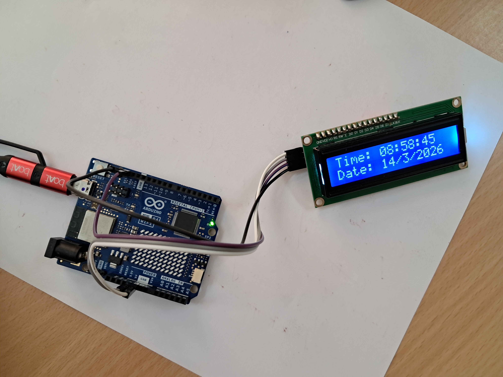
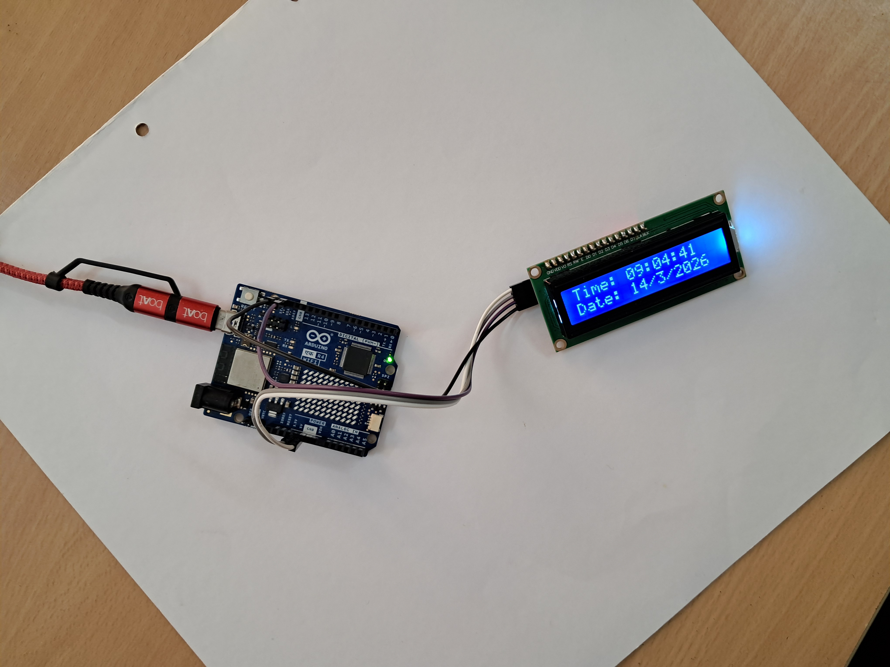
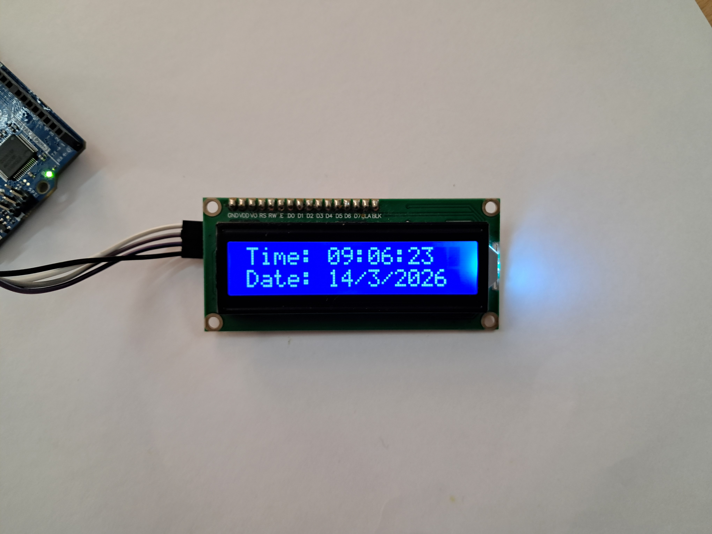
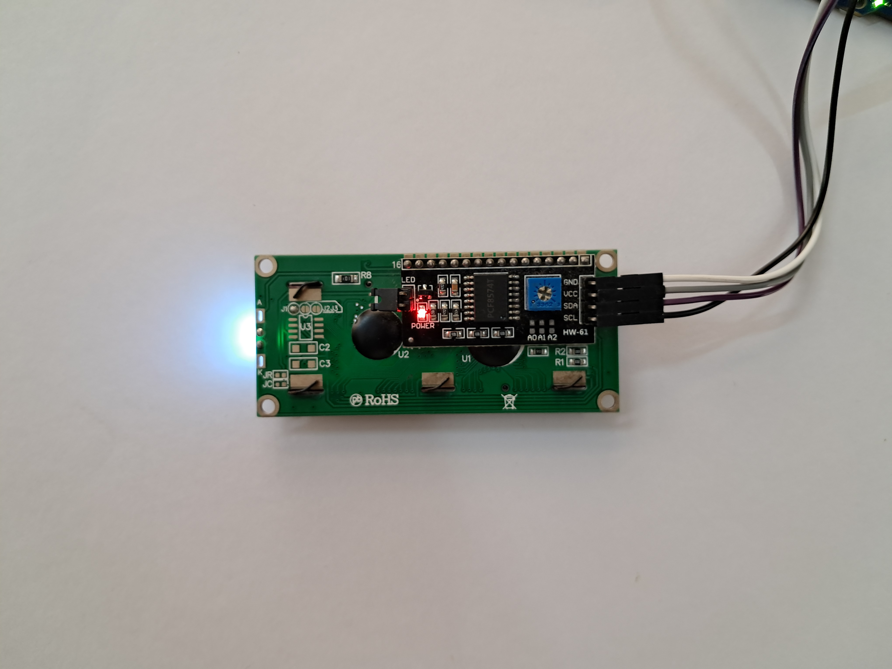
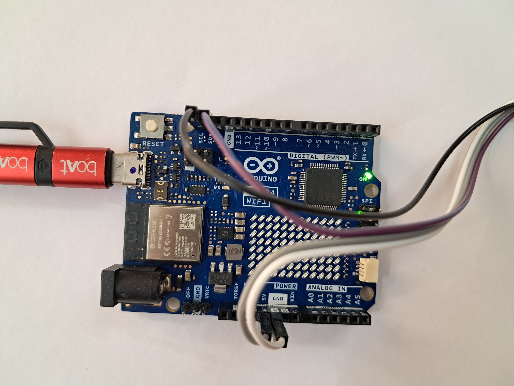

# Arduino UNO R4 WiFi NTP Real-Time Clock with I2C 1602 LCD

An embedded clock project running on the **Arduino UNO R4 WiFi** microcontroller. The system synchronizes network time using NTP over 2.4 GHz Wi-Fi via the onboard ESP32-S3 module, configures the Renesas RA4M1 internal Real-Time Clock (RTC) peripheral, and displays live time and date on a 16x2 character LCD driven over I2C.

---

## Hardware Overview & Specifications

* **Microcontroller:** Arduino UNO R4 WiFi
  * **Core MCU:** Renesas RA4M1 (ARM Cortex-M4, 48 MHz)
  * **Wireless Bridge:** Espressif ESP32-S3-MINI-1 (2.4 GHz Wi-Fi)
  * **Timekeeping:** Native Renesas RA4M1 internal RTC hardware peripheral
* **Display:** 1602 Character LCD (16 columns × 2 rows, blue backlight, white text)
* **Interface Backpack:** HW-61 I2C daughterboard based on the Texas Instruments / NXP `PCF8574T` I/O expander
* **Default I2C Address:** `0x27` (solder jumpers A0, A1, A2 open)

---

## Wiring Diagram

| 1602 LCD Backpack Pin | Arduino UNO R4 WiFi Pin | Header | Function |
| :--- | :--- | :--- | :--- |
| **GND** | **GND** | Power Header | Ground reference (0V) |
| **VCC** | **5V** | Power Header | +5V DC System Power |
| **SDA** | **SDA** | Top Digital Header (above AREF) | I2C Serial Data |
| **SCL** | **SCL** | Top Digital Header (above AREF) | I2C Serial Clock |

> **Note:** The dedicated `SDA` and `SCL` pins above `AREF` connect to the same primary I2C bus (`Wire`) as pins `A4` and `A5`. Using the dedicated pins leaves analog pins `A4` and `A5` free for external analog sensors.

---

## Hardware Gallery & Bench Setup

### 1. Prototype Bench Overview

*Arduino UNO R4 WiFi powered via USB-C, actively driving the 16x2 I2C display.*

### 2. Live Time and Date Display

*Real-time operation displaying synchronized Indian Standard Time (IST, UTC+5:30).*

### 3. Display Detail

*Text alignment showing 24-hour time formatting and date.*

### 4. HW-61 I2C Backpack & PCF8574T Driver

*Rear view of LCD module showing PCF8574T expander, address pads A0-A2, contrast trimpot, and backlight jumper.*

### 5. UNO R4 WiFi Connection Detail

*Close-up of jumper wire routing to 5V, GND, SDA, and SCL headers.*

---

## Required Libraries

* **`WiFiS3`** — Bundled with the official Arduino UNO R4 core.
* **`RTC`** (`Arduino_RTC`) — Bundled with the official Arduino UNO R4 core.
* **`Wire`** — Built-in Arduino I2C communication library.
* **`LiquidCrystal_I2C`** — By Frank de Brabander (installable via Arduino Library Manager).

---

## Setup & Flashing Instructions

1. **Install Board Support:** Open the Arduino IDE, go to **Tools > Board > Boards Manager**, search for **Arduino UNO R4 Boards**, and install the package.
2. **Install LCD Library:** Go to **Tools > Manage Libraries**, search for **LiquidCrystal I2C by Frank de Brabander**, and click install.
3. **Configure Wi-Fi Credentials:**
   * Open `rtc_lcd_final.ino`.
   * Update `WIFI_SSID` and `WIFI_PASS` with your 2.4 GHz Wi-Fi credentials.
   * Adjust `TZ_OFFSET` if your local timezone differs from IST (`19800` seconds = UTC+5:30).
4. **Select Board & Port:** Under **Tools**, select **Board: Arduino UNO R4 WiFi** and choose the correct serial COM port.
5. **Upload Sketch:** Click **Upload**.

---

## Troubleshooting Guide

* **LCD Shows Solid Blocks or Blank Screen:** Rotate the blue potentiometer on the rear of the HW-61 backpack with a precision screwdriver to adjust the LCD contrast.
* **I2C Address Mismatch:** If your backpack uses a `PCF8574AT` chip instead of `PCF8574T`, change the initialization address in line 22 from `0x27` to `0x3F`.
* **"Sync failed! Check WiFi/pass":** Ensure your Wi-Fi router is broadcasting on 2.4 GHz (ESP32-S3 on UNO R4 does not connect to 5 GHz-only SSIDs).
* **Time Retention on Power-Down:** The internal RTC retains time while powered. To maintain continuous timekeeping across power drops, wire a 3V coin cell battery (CR2032) to the board's `VRTC` and `GND` pins.
